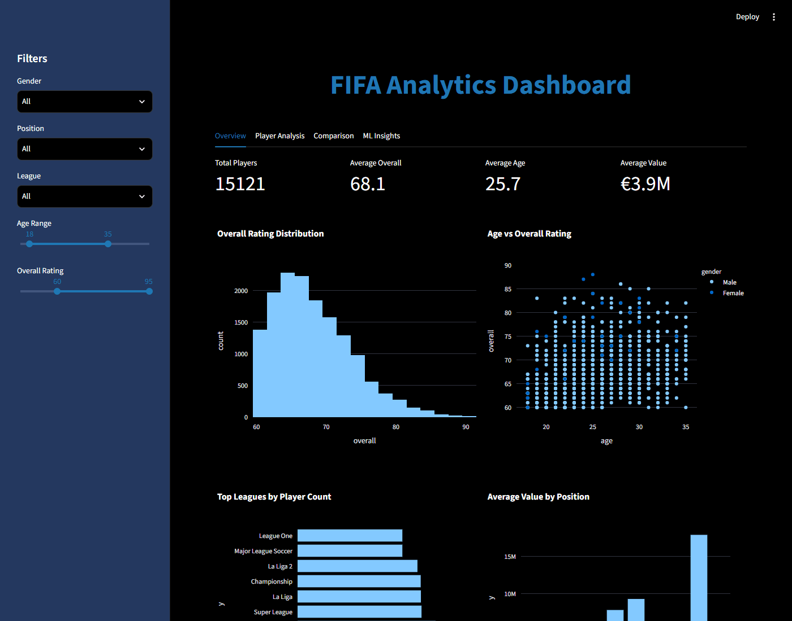
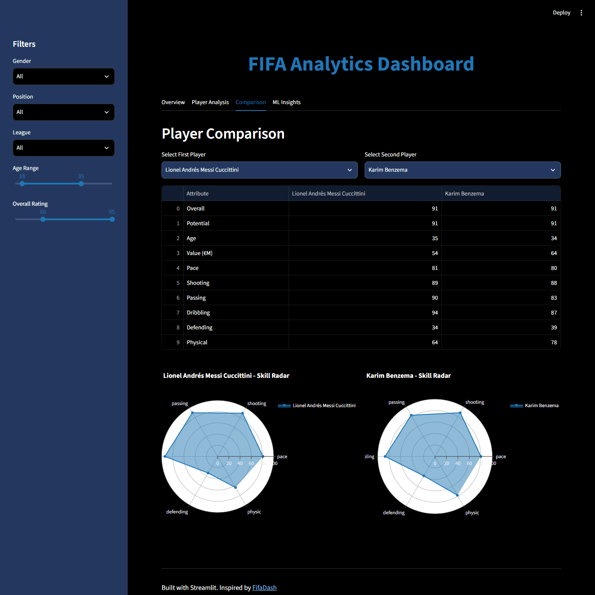
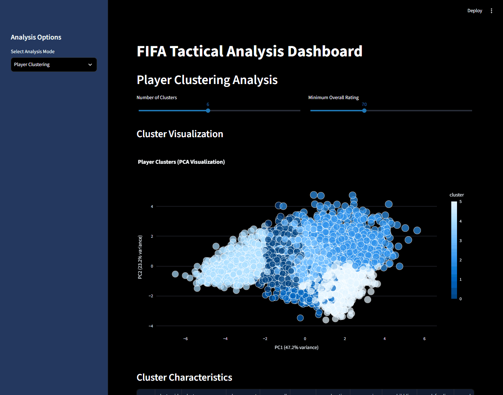

# FIFA Analytics Dashboard

Streamlit dashboards for exploring FIFA 23 player ratings. You can filter players, look at
single players and compare two of them, cluster players by their main attributes and fit a
simple model that predicts market value from ratings. The idea comes from
[FifaDash](https://github.com/EkremBayar/FifaDash) by EkremBayar, which was built in R Shiny.
This version is in Python with Streamlit, Plotly and scikit-learn.

## Screenshots

Taken from the apps running locally on the FIFA 23 rows of the dataset (last update, 13 January 2023: 18,127 male and 832 female players). The files came from the [Hugging Face mirror](https://huggingface.co/datasets/jsulz/FIFA23) of the Kaggle dataset, which is released under CC0.

`app.py`, Overview tab with the default filters:



`app.py`, Comparison tab:



`tactical_analysis.py`, player clustering (6 clusters, overall 70 and above):



## Data

[FIFA 23 Complete Player Dataset](https://www.kaggle.com/datasets/stefanoleone992/fifa-23-complete-player-dataset) on Kaggle.

The CSVs are too large for the repository. Download them and put these two files in `data/`:

- `data/male_players.csv`
- `data/female_players.csv`

The same files are also on Hugging Face ([jsulz/FIFA23](https://huggingface.co/datasets/jsulz/FIFA23)) and can be downloaded there without a Kaggle account. `male_players.csv` covers every FIFA version from 15 to 23 and is about 5.6 GB; the screenshots above only use the FIFA 23 rows.

The apps add a `gender` column and concatenate them. See [data/README.md](data/README.md) for the columns the code uses.

## Apps

There are three independent Streamlit apps.

**`app.py`** - main dashboard

- Sidebar filters: gender, position, league, age range, overall rating range
- Overview: player count, averages, rating histogram, top leagues, age vs. overall scatter
- Player view: basic info and a radar chart of pace / shooting / passing / dribbling / defending / physic
- Comparison: table and radar charts for two players
- ML tab: K-means clustering (2-8 clusters, standardized features) and a random forest value model

**`advanced_analytics.py`**

- Player report: position-weighted performance index and the five most similar players (cosine similarity on the main ratings)
- Market analysis: value vs. overall scatter, correlation heatmap, and "undervalued" players (value per overall point below 80% of the median)
- Value prediction: weighted average of a random forest (0.6) and a gradient boosting model (0.4) on 13 features, with R², MAE and feature importance
- League comparison: player count, average rating, value and age for the 10 largest leagues, plus the same by position

**`tactical_analysis.py`**

- K-means clustering (3-10 clusters) with a 2D PCA plot; clusters get a rule-based label such as "Playmakers" or "Defensive Anchors"
- Best players per position for a 4-3-3 or 4-4-2
- Team builder: pick 11 players and see their averages and total value

## Method notes

- Value models: rows with missing features are dropped, values of €200M or more are treated as outliers, 80/20 train/test split with `random_state=42`.
- The main app retrains its random forest on the full dataset whenever a prediction is requested, so it takes a moment.
- Goalkeepers have no outfield ratings in this dataset, so they are skipped by the similarity search and the advanced value prediction.

## Results

The repository does not store any model outputs. R² and MAE are computed live in the apps and depend on the data files and filters used.

## How to run

```bash
git clone https://github.com/KaanDRoid/fifa-analytics-dashboard.git
cd fifa-analytics-dashboard
python -m venv venv
venv\Scripts\activate          # Windows
# source venv/bin/activate     # macOS/Linux
pip install -r requirements.txt
```

Check that the packages and data files are in place:

```bash
python demo.py
```

Start the apps from the repository root (the paths to `data/` are relative):

```bash
streamlit run app.py
streamlit run advanced_analytics.py --server.port 8502
streamlit run tactical_analysis.py --server.port 8503
```

`setup_and_usage.ipynb` has the same setup steps as a notebook, plus small helpers for checking ports, data columns and memory use.

## Repository layout

```
app.py                  main dashboard
advanced_analytics.py   player reports, market analysis, value model
tactical_analysis.py    clustering, formations, team builder
demo.py                 checks packages, loads the data and prints basic stats
config.py               constants (ports, model settings); not imported by the apps yet
utils/
  analytics.py          value predictor, performance index, similarity, market helpers
  visualizations.py     Plotly chart functions
data/README.md          expected data files and columns
docs/images/            screenshots used in this README
setup_and_usage.ipynb   setup notes and helper code
.streamlit/config.toml  Streamlit theme and server settings
requirements.txt
LICENSE
```

## License

MIT, see [LICENSE](LICENSE).
